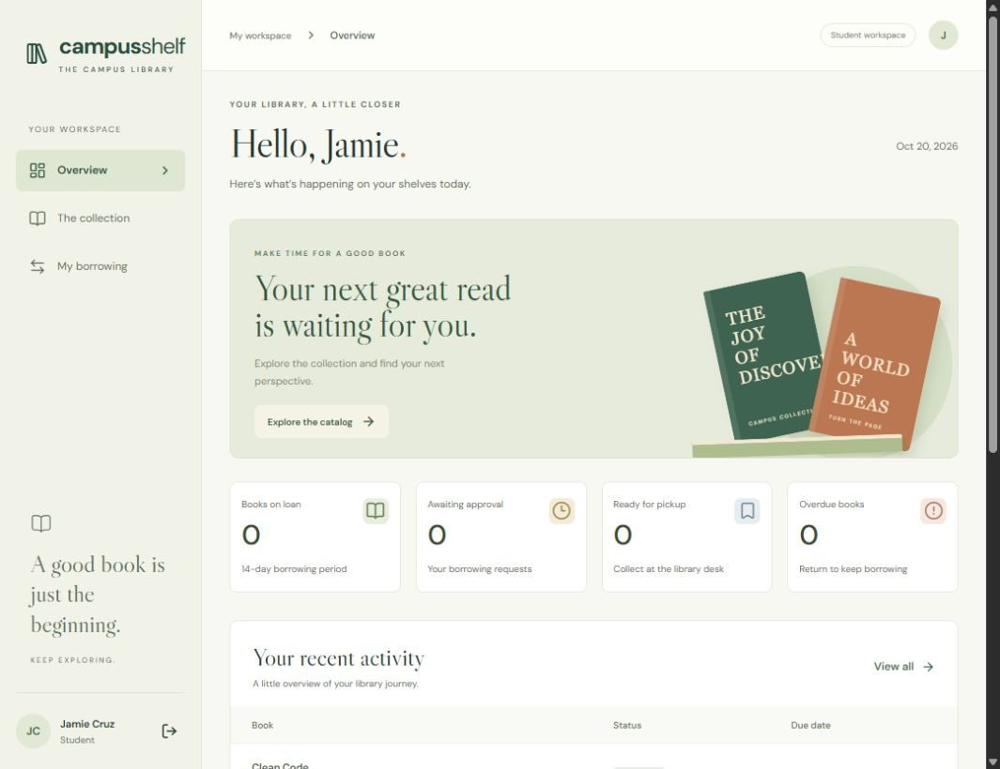

# CampusShelf

A campus library borrowing system built for the Integrative Programming 1 midterm: **React + TypeScript + Axios → ASP.NET Core Web API → EF Core → PostgreSQL**, with real Open Library metadata lookup.

Students discover titles, request a physical copy and track their own loans. Librarians approve requests, check out copies and record returns. Admins also manage account access and delete unused titles. Loan history is protected; a returned copy becomes available again.



## Quick start on this Windows computer

Prerequisites: .NET 10 SDK, Node.js 24, Python 3.11+ and PostgreSQL 17 command-line tools. PostgreSQL binaries are already available on the development computer. No SQLite or in-memory persistence mode is used.

From this directory:

```powershell
python scripts/dev.py start
```

The launcher creates a **separate local PostgreSQL cluster**, bound only to 127.0.0.1 on port 55439, and a campus library database. It generates private local credentials, applies committed EF migrations, seeds eight titles/sixteen copies/three synthetic accounts, installs frontend dependencies and starts both servers hidden in the background.

- Application: http://127.0.0.1:5178
- Swagger: http://127.0.0.1:5088/swagger
- OpenAPI JSON: http://127.0.0.1:5088/swagger/v1/swagger.json
- Generated account passwords: `.runtime/DEMO-ACCOUNTS.md` (private, ignored by Git)
- Admin: `admin@campusshelf.test`
- Librarian: `librarian@campusshelf.test`
- Student: `student@campusshelf.test`

Existing seed accounts are never reset by running the launcher again. Student registration is also available in the interface. After importing or manually adding a title, open it and add physical copies before it can be borrowed.

Stop the project's processes and its own PostgreSQL cluster without deleting records:

```powershell
python scripts/dev.py stop
```

`Start.ps1` and `Stop.ps1` wrap those commands. Keep `.runtime/` out of source control and shared archives: it contains credentials, PostgreSQL files and local logs. No shared default password is committed. `.runtime/config.json` and demo credentials must remain accessible only to trusted local users. If PostgreSQL tools are elsewhere, set `PG_BIN` to their bin directory. Ports 5088/5178/55439 must be free. Startup never deletes an existing project database.

If npm reports a certificate error behind a managed network, use Node 24's `NODE_USE_SYSTEM_CA=1` (already used by the launcher); install your organization's trusted CA if needed. Do not disable TLS verification.

## Use an existing PostgreSQL server / Linux setup

Create a private database and dedicated user using your PostgreSQL administrator tools. Supply secrets through environment variables or .NET user secrets, never committed appsettings. The app fails startup without the key and database configuration.

```text
ConnectionStrings__Library=Host=127.0.0.1;Port=5432;Database=campusshelf;Username=your_app_user;Password=your_private_password
Jwt__Key=<at least 32 random bytes, preferably a generated 48-byte base64url value>
Seed__Password=<private 10–128 character password with uppercase, lowercase and a digit>
ASPNETCORE_ENVIRONMENT=Development
ASPNETCORE_URLS=http://127.0.0.1:5088
```

Then:

```text
dotnet tool restore
dotnet build backend/CampusShelf.Api
dotnet run --project backend/CampusShelf.Api --no-launch-profile -- --seed
dotnet run --project backend/CampusShelf.Api --no-launch-profile
```

`--seed` applies EF Core migrations, seeds demonstration records if absent, then exits. `--migrate` applies only migrations and exits. Seeding is an explicit operator action; normal server startup does not migrate a production database automatically.

In a second terminal:

```text
cd frontend
npm ci
npm run dev
```

For the same-origin development proxy keep the API on 5088 and Vite on 5178. The frontend intentionally stores its JWT only in memory: reload requires sign-in, and account data stays persisted. Tokens expire after thirty minutes. Logout revokes all sessions for that account.

## Verification

Run from the repository root with local PostgreSQL started:

```text
dotnet build backend/CampusShelf.Api
python scripts/integration_test.py
python scripts/export_openapi.py
```

From frontend:

```text
npm run lint
npm run build
npm audit
```

The integration suite starts its own API and controlled HTTP provider against a new `campusshelf_test_...` PostgreSQL database; it never uses the demo database and removes only its newly created test database. It covers role restrictions, student ownership, validation, borrowing/return, competing last-copy requests, limits/overdue rules, CRUD/stale changes, provider response/HTTP error/malformed JSON/timeout, session revocation, real database constraints and API restart persistence. Controlled provider fixtures are test-only; the normal running app uses real Open Library. See [executed evidence](docs/VERIFICATION.md).

CI uses PostgreSQL 17 and repeats the API/database suite, migration-drift check, frontend lint/build and dependency audits. A committed workflow is not itself proof of a successful hosted run: publish the repository and obtain the actual Actions result before claiming that evidence.

## Documents and midterm submission

- [Proposal, requirements, team assignment and AI disclosure](docs/PROPOSAL-AND-REQUIREMENTS.md)
- [Architecture, use cases, ERD and sequence/state diagrams](docs/ARCHITECTURE.md)
- [API and authorization rules](docs/API.md)
- [Rubric evidence and demonstration script](docs/MIDTERM-CHECKLIST.md)
- [Verification results and remaining limitations](docs/VERIFICATION.md)
- [Team collaboration guide](CONTRIBUTING.md)

## Boundaries

This is a tested classroom foundation, not an approved institutional production service. Demonstration data is synthetic. Students self-register without institutional identity verification. No fines, email delivery, password recovery, uploads or automatic reservation expiration are implemented. Requested/Ready copies remain reserved until staff or the borrower cancels them. Login limits and provider cache/rate coordination are per API process. Multi-server abuse protection, public HTTPS deployment, backup/restore operations and load testing remain future work. A database connection check does not establish that all migrations are applied; follow the migration commands. Fonts use Google Fonts when reachable, with local font fallbacks.

The team must still supply real names/contributions, obtain proposal approval, publish meaningful shared GitHub history and perform the individual oral defense. Software alone cannot establish those rubric requirements or guarantee a grade.
