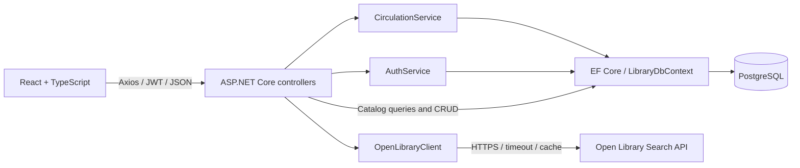
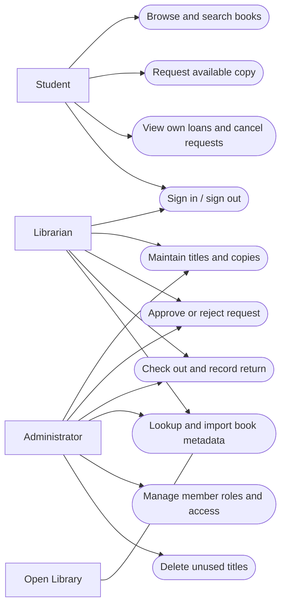
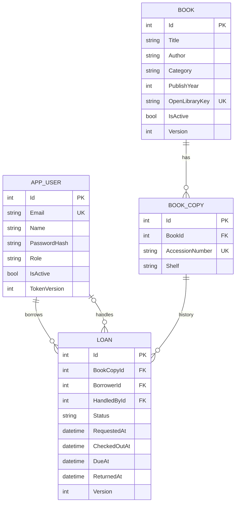
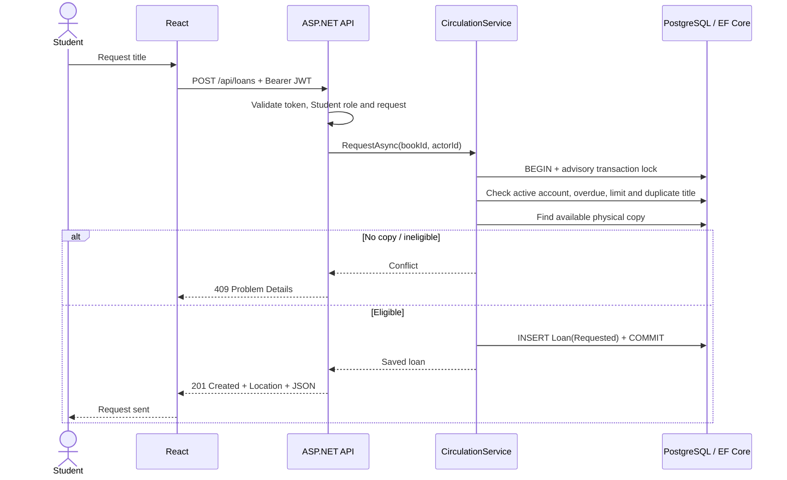
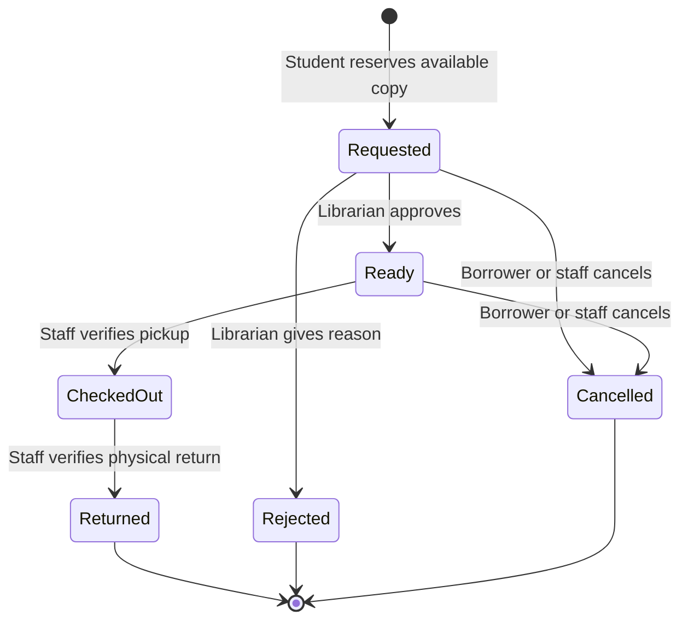

# Architecture, use cases and database design

## Layering

Controllers own HTTP contracts, status codes and role annotations. AuthService handles registration, password verification and token creation. CirculationService owns borrowing limits, ownership checks and legal transitions. EF Core owns relational persistence. OpenLibraryClient owns third-party transport, response normalization, caching and unavailable-service translation. Simple catalog CRUD uses DbContext in its controller; an additional repository abstraction is intentionally omitted for this small application.

## Use-case diagram

## ERD

Books and physical copies are separate so a title's metadata is not repeated for each copy. Each Loan references one actual copy and a borrower. HandledBy points to the most recent actor; this field is not a full immutable audit history. Multiple authors are a display string, an explicit midterm simplification; normalized author/edition entities are a possible later extension. Category is a bounded string, not a separate lookup table. Availability and overdue status are derived from persisted loan state rather than stored as competing truth.

PostgreSQL enforces foreign keys, unique accession/email/provider identifiers, role/status/year/date checks and one active reservation per physical copy via a partial unique index. Deleting loan history is deliberately unsupported. Delete unused copies/titles; archive used titles.

## Borrowing sequence

## Loan lifecycle

Requested and Ready reserve stock immediately. There is no automatic reservation expiration in this version; staff must cancel abandoned requests. Checkout sets a 14-day UTC due timestamp. UI formats dates in Asia/Manila. Student identity always comes from the token, never a borrower ID sent in the request. Ownership filtering returns 404 for another student's loan. Tokens are never stored in localStorage/sessionStorage.

## Concurrency and deployment limits

Circulation, copy mutations, account access changes and title edits acquire the same PostgreSQL transaction-scoped advisory lock. This intentionally serializes a small campus's critical mutations, making the three-loan limit and last-copy allocation deterministic across API processes. The partial unique index remains the final per-copy safety net. Book/loan Version fields reject stale edits/transitions with 409. Reads remain concurrent. Provider rate limiting/cache and login rate limits are process-local; a public multi-server deployment requires shared controls. No load/soak or production certification is claimed.
